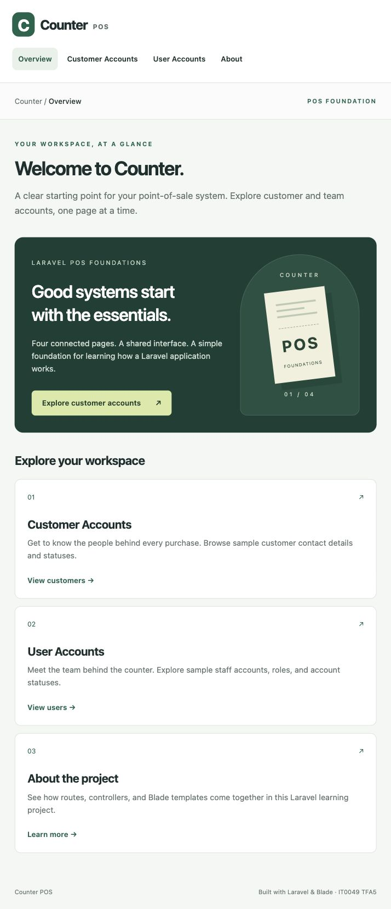
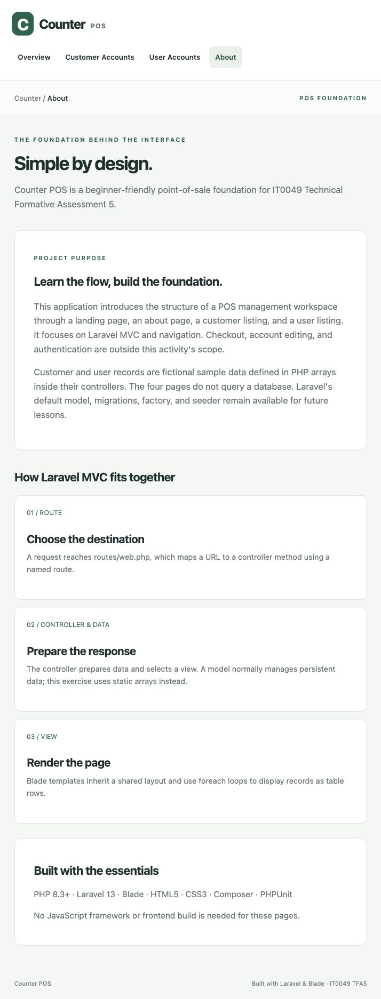
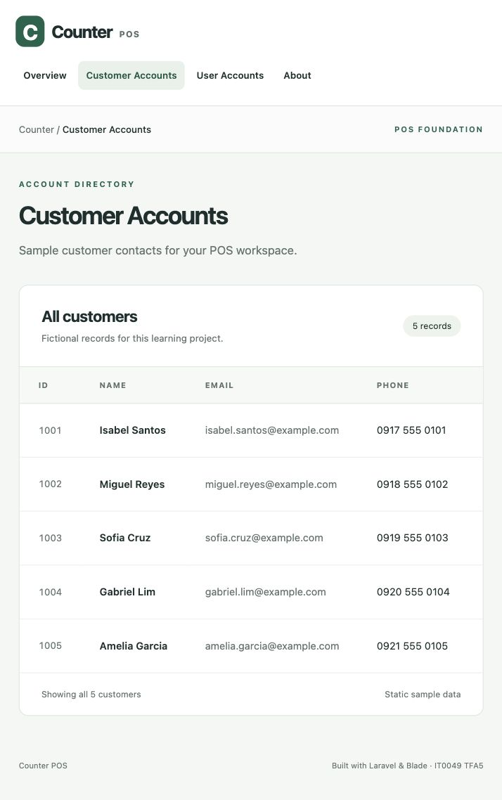
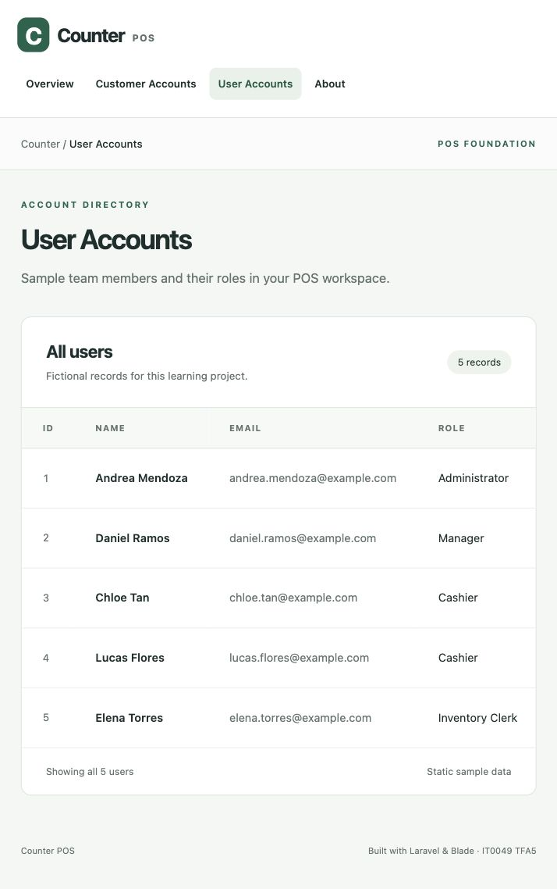

# Counter POS — Laravel POS Foundations

IT0049 Technical Formative Assessment 5: From Zero to Four Pages, Again.

Counter POS is a four-page Laravel application for learning routes, controllers, and Blade. It provides a welcome page, project information, and two read-only account directories using fictional sample data. This foundation does not implement checkout, CRUD, or authentication.

## Features

- Four named GET routes handled by three controllers.
- Five customer records and five user records defined in static PHP arrays.
- Blade inheritance with `@extends`, `@section`, and `@yield`; both directories use `@foreach`.
- Responsive shared navigation with active-page highlighting, keyboard focus styles, a skip link, and scrollable tables.
- Local CSS without a JavaScript framework, external fonts, or a frontend build requirement.
- Feature tests for pages, navigation, records, and database independence.

## Technology stack and prerequisites

- Laravel 13 (installed framework: 13.42.0; exact dependencies in composer.lock).
- PHP 8.3 or later supported by the locked packages; developed and tested on PHP 8.5.10.
- Composer 2 (tested with 2.10.3), HTML5, CSS3, Blade, and PHPUnit 12.
- Git for submission, and internet access for initial Composer downloads.
- PHP extensions: Ctype, cURL, DOM, Fileinfo, Filter, Hash, Mbstring, OpenSSL, PCRE, PDO, Session, Tokenizer, and XML. Development test packages also need XMLWriter. Run `composer check-platform-reqs` for the complete installed dependency check.

A global Laravel installer is optional. Node.js, npm, a database server, and database migrations are not required for these four pages. Default frontend scaffold files remain available but are not loaded by the layout.

## Installation and Composer setup

After cloning your repository, enter its root directory:

```sh
cd laravel-pos
composer install
cp .env.example .env
php artisan key:generate
composer check-platform-reqs
php artisan serve
```

Open http://127.0.0.1:8000. Stop the development server with Ctrl+C.

For this already-prepared local copy, dependencies and the local key are already installed. You can start it with `php artisan serve`.

Alternatively, `composer run setup` installs dependencies, creates .env only if missing, and generates a key. Use it for initial setup; do not regenerate an existing production key. `composer run dev` starts the Artisan server. No `npm install` or `npm run build` is needed.

If Composer reports a missing PHP version or extension, install/enable that prerequisite for your CLI PHP and rerun `composer install`; do not bypass platform requirements.

## Environment configuration

The committed `.env.example` has a blank application key. Your local `.env` must contain a generated key and is ignored by Git.

```dotenv
APP_NAME="Counter POS"
APP_ENV=local
APP_DEBUG=true
APP_URL=http://localhost:8000
SESSION_DRIVER=file
CACHE_STORE=file
QUEUE_CONNECTION=sync
```

File sessions/cache and synchronous queues avoid Laravel's default database-backed infrastructure. After changing environment values, run `php artisan config:clear`. The `storage/` and `bootstrap/cache/` directories must be writable by PHP.

## Available routes

| Method | URL | Route name | Controller method | Blade view |
| --- | --- | --- | --- | --- |
| GET | `/` | `home` | `PageController@index` | `home` |
| GET | `/about` | `about` | `PageController@about` | `about` |
| GET | `/customers` | `customers.index` | `CustomerController@index` | `customers` |
| GET | `/users` | `users.index` | `UserController@index` | `users` |

Laravel also supports HEAD requests on these routes and includes its framework health endpoint. Inspect the assignment routes with `php artisan route:list --except-vendor`.

## Project structure

```text
app/
  Http/Controllers/
    PageController.php
    CustomerController.php
    UserController.php
  Models/User.php                 # Default Laravel model, not queried by these pages
bootstrap/app.php
config/
database/
  factories/UserFactory.php       # Default scaffold retained
  migrations/                    # Default users/cache/jobs migrations retained
  seeders/DatabaseSeeder.php      # Default scaffold retained
public/
  index.php
  css/app.css                    # Styles loaded directly, without Vite
resources/views/
  layouts/app.blade.php           # Shared document, navigation, header, footer
  home.blade.php
  about.blade.php
  customers.blade.php
  users.blade.php
routes/web.php
tests/Feature/PagesTest.php
.env.example
composer.json
composer.lock
phpunit.xml
```

## MVC explained

A request such as `/customers` matches a route in `routes/web.php`. The route calls `CustomerController::index()`. The controller prepares a PHP array and passes it to `customers.blade.php`. Blade loops through that array and places the page content inside `layouts/app.blade.php`.

- **Model:** normally represents persistent data and business rules. The default User model remains intact, but this assignment intentionally uses controller arrays instead of querying models.
- **View:** handles HTML presentation. The shared layout supplies navigation and uses `@yield`; individual pages use `@extends` and `@section`.
- **Controller:** prepares data and selects the view. `PageController` returns the landing/about views; `CustomerController` supplies customer ID, name, email, phone, and status; `UserController` supplies user ID, name, email, role, and status.

Named `route()` links keep navigation connected to the route definitions. `request()->routeIs()` highlights the active page. Blade's `{{ }}` output escapes record values.

## Static PHP arrays and database files

Each account controller defines a local array with five associative records. This is the required temporary data source; it is reconstructed on each request and changes are made directly in the source. No account records are retrieved from a database, and no database population is required.

Laravel's default migrations, seeder, factory, and model are retained for the submission requirement. The standard project creation command initially created and migrated a local SQLite file; it is ignored by Git and is not required by the pages. The default seeder creates a separate test model account only when explicitly executed and does not supply the account table pages.

For an optional future database lesson, with the SQLite PDO extension installed, create the local SQLite file and run the default migrations/seeder:

```sh
php -r "file_exists('database/database.sqlite') || touch('database/database.sqlite');"
php artisan migrate --seed
```

This optional command writes to your configured database. The four page listings remain static afterward. An SQL export is unnecessary because migration and seeder files are included.

## Testing

```sh
php artisan route:list --except-vendor
php artisan test --compact
composer check-platform-reqs
vendor/bin/pint --format agent
```

`PagesTest` checks HTTP success, every navigation destination on every page, exactly one active navigation link, at least five records per controller array, rendered field values and row counts, and the required `@foreach` directives. It also verifies that the pages execute no database queries and still load with a nonexistent database path. Tests do not use `RefreshDatabase` or populate any records.

The prepared project passed 6 tests with 94 assertions on PHP 8.5.10. Live Artisan HTTP checks returned 200 on all four routes and the CSS asset. See `SUBMISSION.md` for hand-in steps and `IMPLEMENTATION_REPORT.md` for validation details.

For a manual check, start `php artisan serve`, visit each URL, click the navigation links, and check table scrolling on a narrow screen. To change ports, use `php artisan serve --port=8001`.

## Deployment guidance

Choose a host capable of running PHP/Laravel; a static-only host such as GitHub Pages cannot execute this application. The host must support the PHP version and extensions required by composer.lock.

1. Upload or deploy the Git repository and run `composer install --no-dev --optimize-autoloader`.
2. Create the production environment securely. Set `APP_ENV=production`, `APP_DEBUG=false`, and `APP_URL` to the real HTTPS URL. Generate a new production `APP_KEY` once with `php artisan key:generate`; preserve it across later deployments.
3. Keep `SESSION_DRIVER=file`, `CACHE_STORE=file`, and `QUEUE_CONNECTION=sync`. No migrations are needed for the four pages.
4. Point the web server document root at `public/`, never the project root. Configure requests to reach `public/index.php` and make `storage/` and `bootstrap/cache/` writable.
5. Run `php artisan optimize`, enable HTTPS, and verify all four public URLs plus the stylesheet.
6. Persistent writable storage is needed for file sessions/cache. On a multi-server deployment, use shared storage or appropriately configured shared drivers; this assignment targets a simple single-instance host.

Do not use Artisan's development server as a production web server. Do not publish `.env` or enable production debug output. The source repository is available through the submission link below. Hosting authentication and a real deployment are still required; no hosted URL has been invented.

Official references: [Laravel installation](https://laravel.com/docs/13.x/installation), [deployment](https://laravel.com/docs/13.x/deployment), [routing](https://laravel.com/docs/13.x/routing), and [Blade](https://laravel.com/docs/13.x/blade).

## Screenshots

Screenshots captured from the running local application. On narrow screens, scroll the account tables horizontally to see every column.

### Landing page



### About page



### Customer Accounts



### User Accounts



## Submission links

- GitHub repository: `[MariusKii/laravel-pos](https://github.com/MariusKii/laravel-pos)`
- Hosted application: `[Replace with your verified live URL]`
- Student/group name, section, and professor: `[Complete your assignment cover sheet]`
